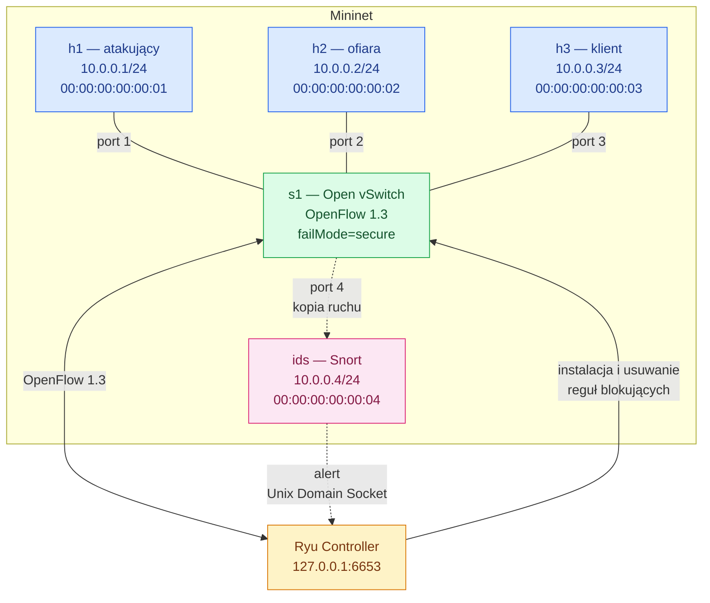

# sdn-reactive-firewall

Reaktywny firewall dla sieci SDN — wykrywanie ataków przy pomocy Snort IDS oraz
własnych algorytmów behawioralnych, a następnie automatyczne instalowanie reguł
blokujących w przełączniku OpenFlow przez kontroler Ryu.

Projekt realizowany w ramach przedmiotu SSP.

## 1. Literatura

### Artykuł 1

**SDN-Based Intrusion Detection System for Early Detection and Mitigation of DDoS Attacks**

Manso P., Moura J., Serrão C., *Information*, 2019, 10(3), 106.
DOI: [10.3390/info10030106](https://doi.org/10.3390/info10030106) ·
[pełny tekst](https://www.mdpi.com/2078-2489/10/3/106)

Autorzy zbudowali system wykrywania i mitygacji ataków DDoS działający u źródła
ataku, a nie po stronie ofiary. Open vSwitch kopiuje cały ruch na port lustrzany,
na którym nasłuchuje Snort IDS. Po wykryciu anomalii Snort przesyła alert do
kontrolera Ryu przez gniazdo domenowe Uniksa, a kontroler instaluje w przełączniku
regułę odrzucającą ruch atakującego. Skuteczność zweryfikowano w trzech
scenariuszach generowanych narzędziem hping3: zwykłym zalewie pakietami, ataku ze
sfałszowanym adresem źródłowym oraz ataku z manipulacją rozmiarem pakietu.
Mierzono czas mitygacji, średni czas RTT oraz straty pakietów.

Istotny szczegół: w scenariuszu ze sfałszowanym adresem IP reguła blokująca
dopasowuje ruch po **adresie MAC** źródła (`dl_src`), ponieważ `hping3 -a`
podmienia wyłącznie nagłówek warstwy 3. Działa to tylko dlatego, że przełącznik
jest przełącznikiem brzegowym samego atakującego.

**Co z tego bierzemy:** architekturę z portem lustrzanym, sposób przekazywania
alertów ze Snorta do kontrolera, logikę instalowania reguł blokujących oraz całą
metodykę pomiarową wraz ze scenariuszami testowymi.

### Artykuł 2

**Implementing an intrusion detection and prevention system using software-defined networking: Defending against port-scanning and denial-of-service attacks**

Birkinshaw C., Rouka E., Vassilakis V. G., *Journal of Network and Computer
Applications*, 2019, 136, s. 71–85.
DOI: [10.1016/j.jnca.2019.03.005](https://doi.org/10.1016/j.jnca.2019.03.005) ·
[pełny tekst](https://eprints.whiterose.ac.uk/id/eprint/144195/1/SDN_IDPS_Birkinshaw_et_al.pdf)

Autorzy zaproponowali system IDPS zrealizowany jako moduł kontrolera POX. W
odróżnieniu od artykułu 1 nie korzystają z zewnętrznego IDS-a — detekcja odbywa
się na podstawie przechwytywanych zdarzeń PacketIn, a ten sam moduł od razu
instaluje regułę blokującą. Opisano trzy algorytmy progowe:

- **Port Bingo** — wykrywanie skanowania portów. Dla każdej pary hostów system
  prowadzi zbiór odwiedzonych portów docelowych należących do listy około
  dwudziestu portów TCP najczęściej odpytywanych przez skanery. Przekroczenie
  progu liczby *różnych* portów w zadanym oknie czasowym klasyfikuje hosta jako
  skaner. Algorytm mierzy szerokość skanu, a nie wolumen ruchu.
- **Credit-Based Threshold Random Walk** — zliczanie nieodwzajemnionych prób
  połączenia. Każdy pakiet TCP SYN zwiększa licznik hosta, każdy SYN/ACK od
  serwera go zmniejsza. Host trafiający w zamknięte porty narasta licznik aż do
  progu i zostaje zablokowany.
- **Rate Limiting** — ograniczanie liczby nowych połączeń w jednostce czasu,
  rozszerzone przez autorów na ruch TCP, UDP oraz ICMP.

Ograniczenie wynikające z architektury: detekcja oparta na PacketIn widzi wyłącznie
pakiety, które chybiły tablicę przepływów. Dla skanowania portów to wystarcza, bo
skan generuje lawinę nowych przepływów. Do wykrywania ataków zalewowych autorzy
dołożyli osobną ścieżkę opartą na cyklicznym odpytywaniu statystyk przepływów.

**Co z tego bierzemy:** reimplementację algorytmów Port Bingo oraz Rate Limiting
jako własnego modułu kontrolera Ryu, drugą klasę ataku w postaci skanowania portów
oraz sposób oceny skuteczności przez pomiar fałszywych alarmów i przeoczeń.

## 2. Zakres własny

Obie publikacje instalują reguły blokujące na stałe — zablokowany host nie
odzyskuje łączności bez interwencji administratora. W naszym rozwiązaniu reguły
wygasają automatycznie dzięki polom `idle_timeout` i `hard_timeout` protokołu
OpenFlow, co pozwala zbadać zależność między czasem utrzymywania blokady a liczbą
niepotrzebnie odciętych hostów.

Drugim elementem własnym jest zestawienie na jednym stanowisku detekcji
sygnaturowej (Snort, za artykułem 1) i progowej (własny moduł, za artykułem 2)
oraz porównanie obu metod pod kątem czasu reakcji i liczby fałszywych alarmów.

## 3. Wykorzystywane technologie

| Technologia | Zastosowanie |
|---|---|
| Mininet | Emulacja środowiska sieciowego |
| Open vSwitch | Przełączanie ruchu i obsługa OpenFlow |
| Ryu Controller | Zarządzanie siecią SDN i instalowanie reguł przepływu |
| Snort IDS | Sygnaturowa detekcja złośliwego ruchu |
| Python | Implementacja topologii i logiki detekcji |
| hping3 | Generowanie ruchu atakującego typu flood |
| nmap | Generowanie ruchu skanującego porty |
| Wireshark | Analiza i monitorowanie ruchu sieciowego |

## 4. Topologia



### Elementy topologii

- **h1 — atakujący:** generuje ruch atakujący (hping3, nmap).
- **h2 — ofiara:** host będący celem ataku.
- **h3 — klient:** generuje ruch legalny, służy do pomiaru wpływu ataku na QoS.
- **ids — Snort:** host analizujący kopię ruchu z portu lustrzanego.
- **s1 — Open vSwitch:** przełącznik OpenFlow 1.3 z portem lustrzanym na porcie 4.
- **Ryu Controller:** kontroler instalujący reguły blokujące.

Adresy MAC są przypisane na sztywno, ponieważ reguły blokujące dopasowują ruch po
adresie źródłowym warstwy 2 — przy adresach losowanych przez Mininet reguły
trzeba byłoby budować od nowa przy każdym uruchomieniu.

Przełącznik pracuje w trybie `failMode=secure`, więc bez działającego kontrolera
nie przepuszcza żadnego ruchu. Dla firewalla to jedyne poprawne ustawienie —
awaria kontrolera nie może otwierać sieci.

## 5. Uruchomienie

Wymagania: Ubuntu 22.04, Mininet, Open vSwitch, Ryu, Snort.

Ryu nie jest już rozwijany i nie uruchamia się na Pythonie 3.12 ze względu na
usunięcie z biblioteki standardowej modułu `distutils`. Stąd Ubuntu 22.04
z Pythonem 3.10, a nie nowsze wydanie.

Kolejność uruchamiania ma znaczenie — przy `failMode=secure` sieć bez kontrolera
nie przepuszcza ruchu.

```bash
# 1. kontroler
ryu-manager firewall.py

# 2. topologia (w drugim terminalu)
sudo python3 topology.py
```

Weryfikacja w konsoli Mininetu:

```bash
mininet> pingall
mininet> sh ovs-ofctl -O OpenFlow13 dump-flows s1
mininet> sh ovs-vsctl list Mirror ids_mirror
```

Przykładowy atak:

```bash
mininet> h1 hping3 --flood --icmp 10.0.0.2
mininet> h1 nmap -sS 10.0.0.2
```
