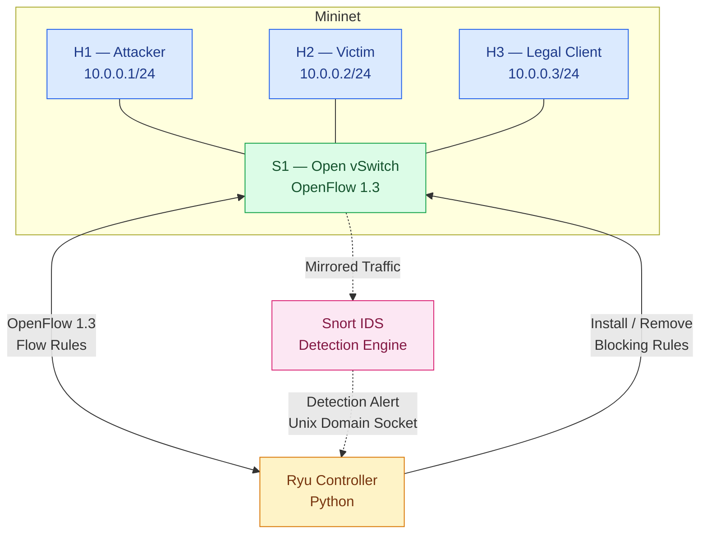

# sdn-reactive-firewall

## Literatura

1. https://www.mdpi.com/2078-2489/10/3/106
2. https://eprints.whiterose.ac.uk/id/eprint/144195/1/SDN_IDPS_Birkinshaw_et_al.pdf

## Literatura 

### Artykuł 1

**SDN-Based Intrusion Detection System for Early Detection and Mitigation of DDoS Attacks**

Manso P., Moura J., Serrão C., *Information*, 2019, 10(3), 106.

Link: https://www.mdpi.com/2078-2489/10/3/106

Autorzy przedstawili system wykrywania i mitygacji ataków DDoS wykorzystujący Snort IDS, kontroler Ryu oraz przełączniki Open vSwitch. Wykrycie ataku powoduje przekazanie informacji do kontrolera, który instaluje reguły blokujące złośliwy ruch. Publikacja stanowi podstawę do opracowania integracji Snorta z kontrolerem Ryu oraz mechanizmu dynamicznego blokowania ruchu.

### Artykuł 2

**Implementing an intrusion detection and prevention system using software-defined networking: Defending against port-scanning and denial-of-service attacks**

Birkinshaw C., Rouka E., Vassilakis V. G., *Journal of Network and Computer Applications*, 2019, 136, s. 71–85.

Link: https://eprints.whiterose.ac.uk/id/eprint/144195/1/SDN_IDPS_Birkinshaw_et_al.pdf

Autorzy zaproponowali system IDPS wykorzystujący algorytmy progowe do wykrywania skanowania portów oraz ataków DoS. W projekcie wykorzystana zostanie koncepcja ograniczania liczby nowych połączeń w jednostce czasu (Rate Limiting), zaimplementowana jako autorski moduł kontrolera Ryu. Publikacja stanowi punkt odniesienia dla behawioralnego podejścia do detekcji ataków.

## 3. Wykorzystywane technologie

| Technologia | Zastosowanie |
|---|---|
| Mininet | Emulacja środowiska sieciowego |
| Open vSwitch | Przełączanie ruchu sieciowego i obsługa OpenFlow |
| Ryu Controller | Zarządzanie siecią SDN i instalowanie reguł przepływu |
| Snort IDS | Sygnaturowa detekcja złośliwego ruchu |
| Python | Implementacja topologii i logiki detekcji |
| hping3 | Generowanie ruchu testowego i ataków DDoS |
| Wireshark | Analiza i monitorowanie ruchu sieciowego |

## 4. Topologia

### Obecna Topologia

### Schemat docelowej topologii

### Elementy topologii

- **H1 – Attacker:** host generujący ruch atakujący.
- **H2 – Victim:** serwer będący celem ataku.
- **H3 – Client:** host generujący legalny ruch.
- **S1 – Open vSwitch:** przełącznik obsługujący protokół OpenFlow.
- **Ryu Controller:** centralny kontroler zarządzający przełącznikiem.
- **Snort IDS:** system analizujący kopiowany ruch sieciowy.

