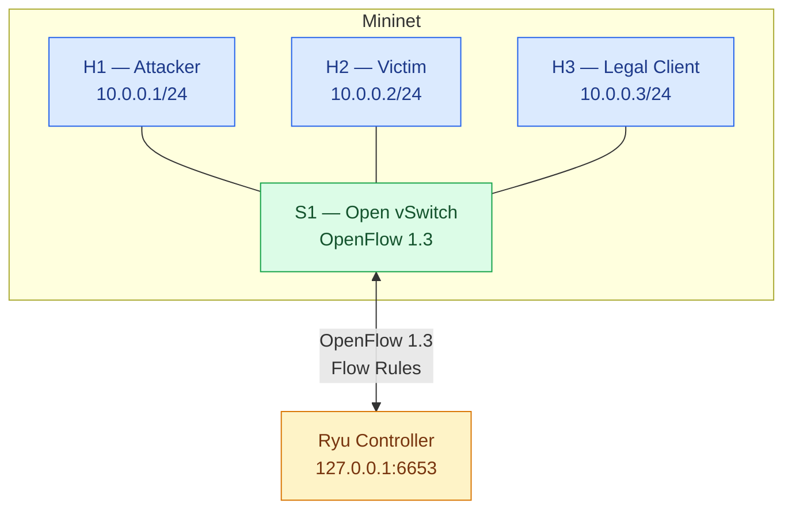
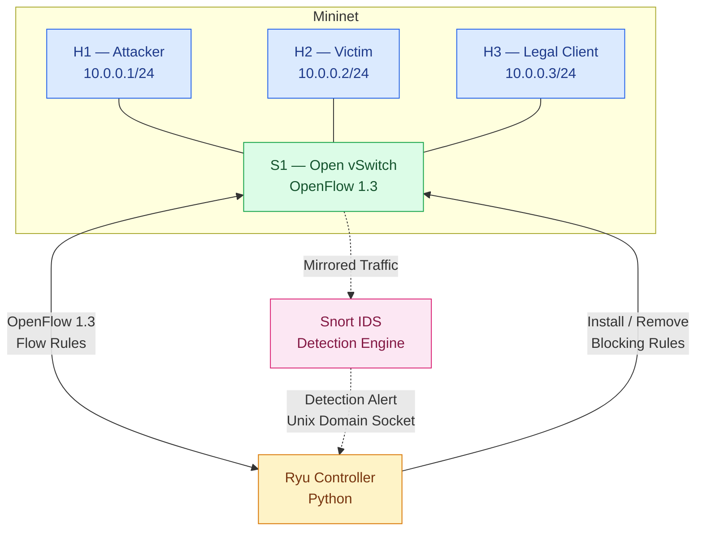

# sdn-reactive-firewall

Reaktywny firewall dla sieci SDN - wykrywanie ataków przy pomocy Snort IDS oraz
własnych algorytmów behawioralnych, a następnie automatyczne instalowanie reguł
blokujących w przełączniku OpenFlow przez kontroler Ryu.

Projekt realizowany w ramach przedmiotu SSP.

## 1. Literatura

### Artykuł 1

**SDN-Based Intrusion Detection System for Early Detection and Mitigation of DDoS Attacks**

Manso P., Moura J., Serrão C., *Information*, 2019, 10(3), 106.
DOI: [10.3390/info10030106](https://doi.org/10.3390/info10030106) ·
[pełny tekst](https://www.mdpi.com/2078-2489/10/3/106)

Autorzy zbudowali system wykrywania i mitygacji ataków DDoS działający u źródła
ataku, a nie po stronie ofiary. Open vSwitch kopiuje cały ruch na port lustrzany,
na którym nasłuchuje Snort IDS. Po wykryciu anomalii Snort przesyła alert do
kontrolera Ryu przez gniazdo domenowe Uniksa, a kontroler instaluje w przełączniku
regułę odrzucającą ruch atakującego. Skuteczność zweryfikowano w trzech
scenariuszach generowanych narzędziem hping3: zwykłym zalewie pakietami, ataku ze
sfałszowanym adresem źródłowym oraz ataku z manipulacją rozmiarem pakietu.
Mierzono czas mitygacji, średni czas RTT oraz straty pakietów.

Istotny szczegół: w scenariuszu ze sfałszowanym adresem IP reguła blokująca
dopasowuje ruch po **adresie MAC** źródła (`dl_src`), ponieważ `hping3 -a`
podmienia wyłącznie nagłówek warstwy 3. Działa to tylko dlatego, że przełącznik
jest przełącznikiem brzegowym samego atakującego.

**Co z tego bierzemy:** architekturę z portem lustrzanym (Port Mirroring), sposób przekazywania alertów ze Snorta do kontrolera Ryu przez gniazdo uniksowe oraz logikę instalowania reguł blokujących. Z metodyki testowej wybieramy jeden scenariusz - podstawowy atak zalewowy generowany narzędziem `hping3 --flood` - oraz pomiar czasu mitygacji, RTT i strat pakietów.

### Artykuł 2

**Implementing an intrusion detection and prevention system using software-defined networking: Defending against port-scanning and denial-of-service attacks**

Birkinshaw C., Rouka E., Vassilakis V. G., *Journal of Network and Computer
Applications*, 2019, 136, s. 71–85.
DOI: [10.1016/j.jnca.2019.03.005](https://doi.org/10.1016/j.jnca.2019.03.005) ·
[pełny tekst](https://eprints.whiterose.ac.uk/id/eprint/144195/1/SDN_IDPS_Birkinshaw_et_al.pdf)

Autorzy zaproponowali system IDPS zrealizowany jako moduł kontrolera POX. W
odróżnieniu od artykułu 1 nie korzystają z zewnętrznego IDS-a - detekcja odbywa
się na podstawie przechwytywanych zdarzeń PacketIn, a ten sam moduł od razu
instaluje regułę blokującą. Opisano trzy algorytmy progowe:

- **Port Bingo** - wykrywanie skanowania portów. Dla każdej pary hostów system
  prowadzi zbiór odwiedzonych portów docelowych należących do listy około
  dwudziestu portów TCP najczęściej odpytywanych przez skanery. Przekroczenie
  progu liczby *różnych* portów w zadanym oknie czasowym klasyfikuje hosta jako
  skaner. Algorytm mierzy szerokość skanu, a nie wolumen ruchu.
- **Credit-Based Threshold Random Walk** - zliczanie nieodwzajemnionych prób
  połączenia. Każdy pakiet TCP SYN zwiększa licznik hosta, każdy SYN/ACK od
  serwera go zmniejsza. Host trafiający w zamknięte porty narasta licznik aż do
  progu i zostaje zablokowany.
- **Rate Limiting** - ograniczanie liczby nowych połączeń w jednostce czasu,
  rozszerzone przez autorów na ruch TCP, UDP oraz ICMP.

Ograniczenie wynikające z architektury: detekcja oparta na PacketIn widzi wyłącznie
pakiety, które chybiły tablicę przepływów. Dla skanowania portów to wystarcza, bo
skan generuje lawinę nowych przepływów. Do wykrywania ataków zalewowych autorzy
dołożyli osobną ścieżkę opartą na cyklicznym odpytywaniu statystyk przepływów.

**Co z tego bierzemy:** reimplementację jednego wybranego mechanizmu - algorytmu Rate Limiting - jako własnego modułu w kontrolerze Ryu do wykrywania ataków zalewowych DoS, oraz sposób oceny czułości algorytmu poprzez pomiar liczby fałszywych alarmów (false positives) przy różnym natężeniu ruchu.

## 2. Zakres własny

Obie publikacje instalują reguły blokujące na stałe - zablokowany host nie odzyskuje łączności bez interwencji administratora. W naszym rozwiązaniu reguły wygasają automatycznie dzięki polom `idle_timeout` i `hard_timeout` protokołu OpenFlow, co pozwala zbadać zależność między czasem utrzymywania blokady a odzyskiwaniem łączności przez niesłusznie zablokowane hosty.

Drugim elementem własnym jest bezpośrednie porównanie na wspólnym stanowisku dwóch podejść do zwalczania ataków zalewowych (DoS): detekcji sygnaturowej (zewnętrzny Snort IDS z artykułu 1) oraz detekcji progowej (własny moduł Rate Limiting w kontrolerze Ryu z artykułu 2) pod kątem czasu reakcji (mitygacji) oraz podatności na fałszywe alarmy.

## 3. Wykorzystywane technologie

| Technologia | Zastosowanie |
|---|---|
| Mininet | Emulacja środowiska sieciowego |
| Open vSwitch | Przełączanie ruchu i obsługa OpenFlow |
| Ryu Controller | Zarządzanie siecią SDN i instalowanie reguł przepływu |
| Snort IDS | Sygnaturowa detekcja złośliwego ruchu |
| Python | Implementacja topologii i logiki detekcji (Rate Limiting) |
| hping3 | Generowanie ruchu atakującego typu flood (DoS) |
| Wireshark | Analiza i monitorowanie ruchu sieciowego |

## 4. Topologia

### Obecna Topologia



### Schemat docelowej topologii




### Elementy topologii

- **H1 – Attacker:** host generujący ruch atakujący.
- **H2 – Victim:** serwer będący celem ataku.
- **H3 – Client:** host generujący legalny ruch.
- **S1 – Open vSwitch:** przełącznik obsługujący protokół OpenFlow.
- **Ryu Controller:** centralny kontroler zarządzający przełącznikiem.
- **Snort IDS:** system analizujący kopiowany ruch sieciowy.

## 5. Uruchomienie

Wymagania: Mininet, Open vSwitch, Ryu.

Ryu nie jest już rozwijany i nie działa na nowych wersjach Pythona, dlatego
instalujemy go w osobnym środowisku z Pythonem 3.9 (sprawdzone na Ubuntu 24.04
w WSL):

```bash
curl -LsSf https://astral.sh/uv/install.sh | sh
~/.local/bin/uv venv ~/ryu-venv --python 3.9
~/.local/bin/uv pip install --python ~/ryu-venv/bin/python "setuptools==67.6.1" wheel pbr
~/.local/bin/uv pip install --python ~/ryu-venv/bin/python --no-build-isolation ryu eventlet==0.30.2
```

Kolejność uruchamiania ma znaczenie - przy `failMode=secure` sieć bez kontrolera
nie przepuszcza ruchu.

```bash
# 1. kontroler
~/ryu-venv/bin/ryu-manager ryu.app.simple_switch_13

# 2. topologia (w drugim terminalu)
sudo service openvswitch-switch start
sudo python3 topology.py
```

Weryfikacja w konsoli Mininetu:

```bash
mininet> pingall
mininet> sh ovs-ofctl -O OpenFlow13 dump-flows s1
```

Przykładowy atak:

```bash
mininet> h1 hping3 --flood --icmp 10.0.0.2
```
